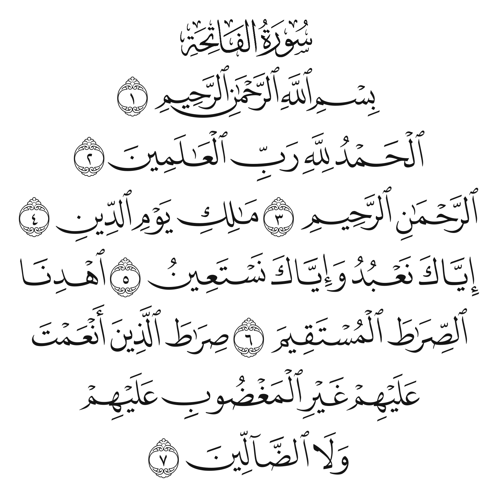
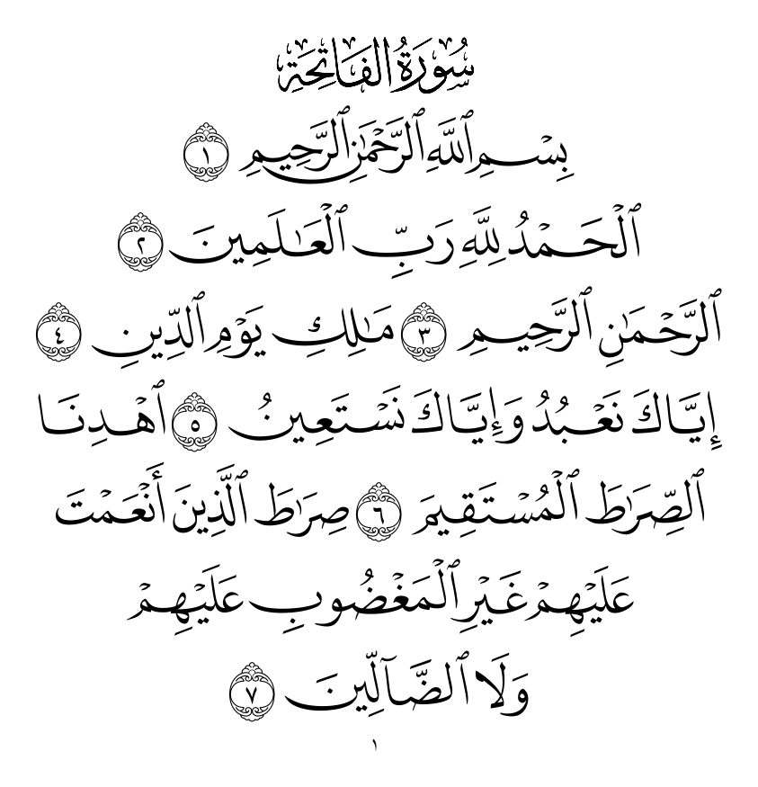
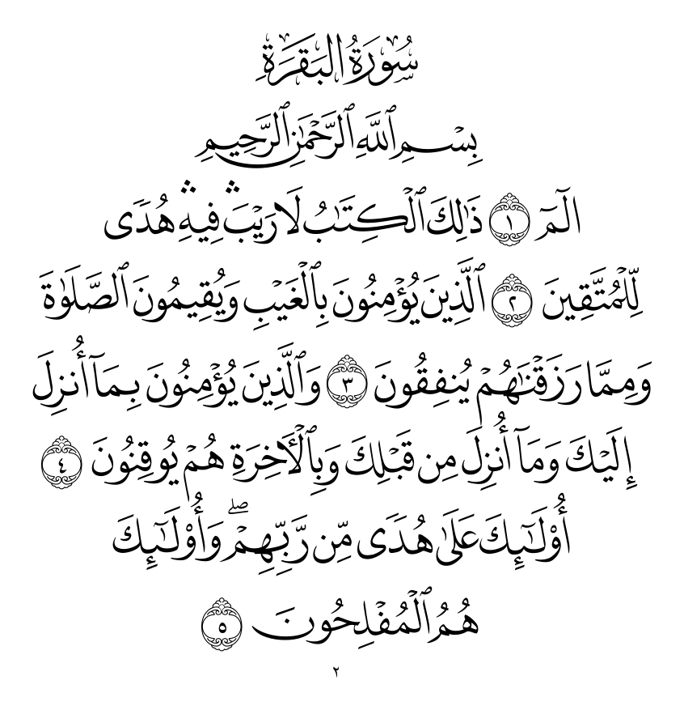
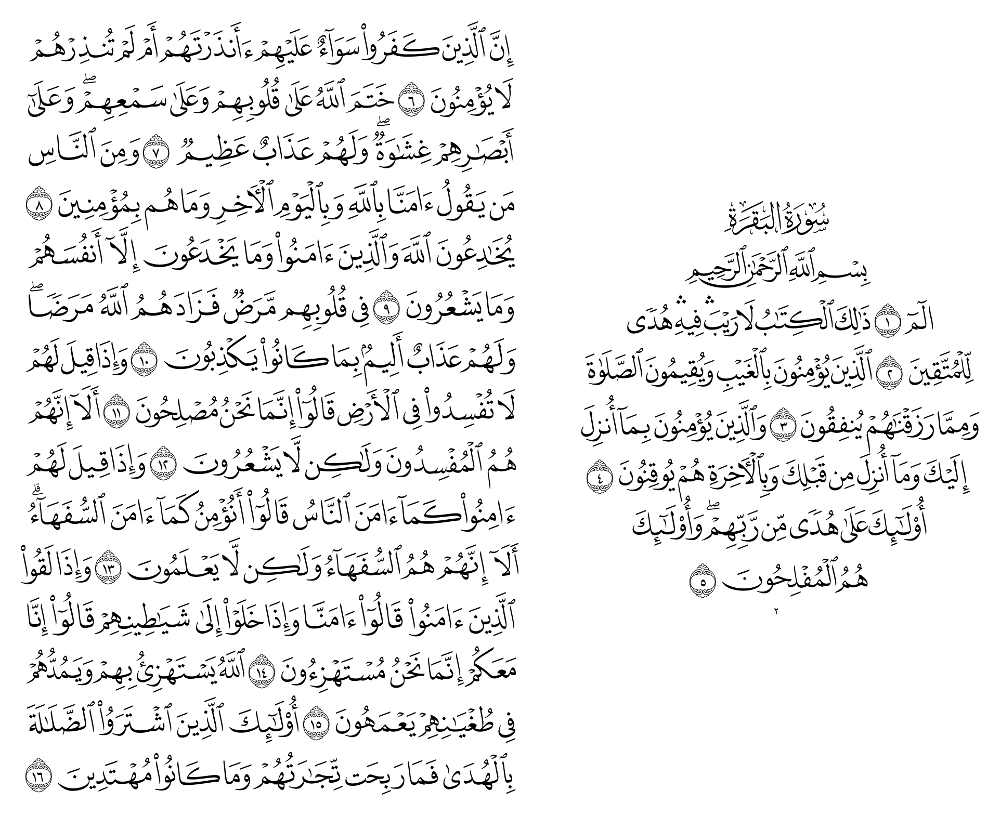
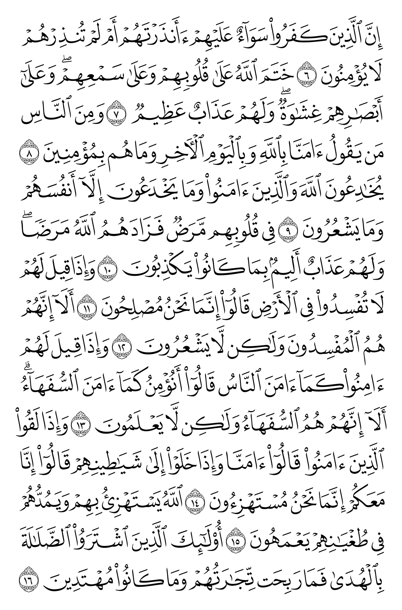
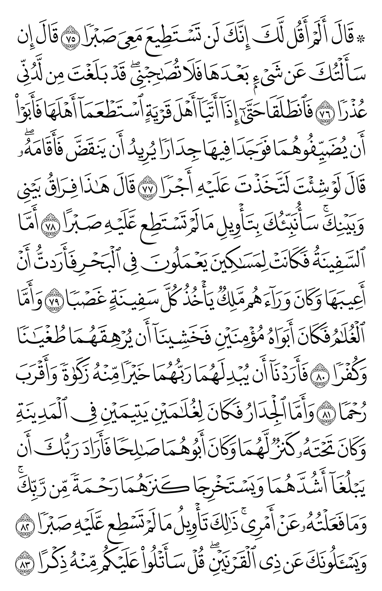
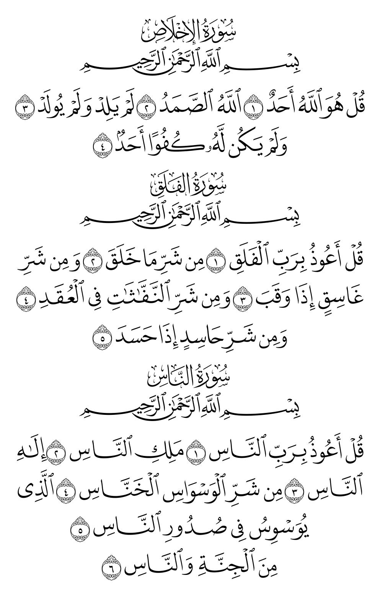
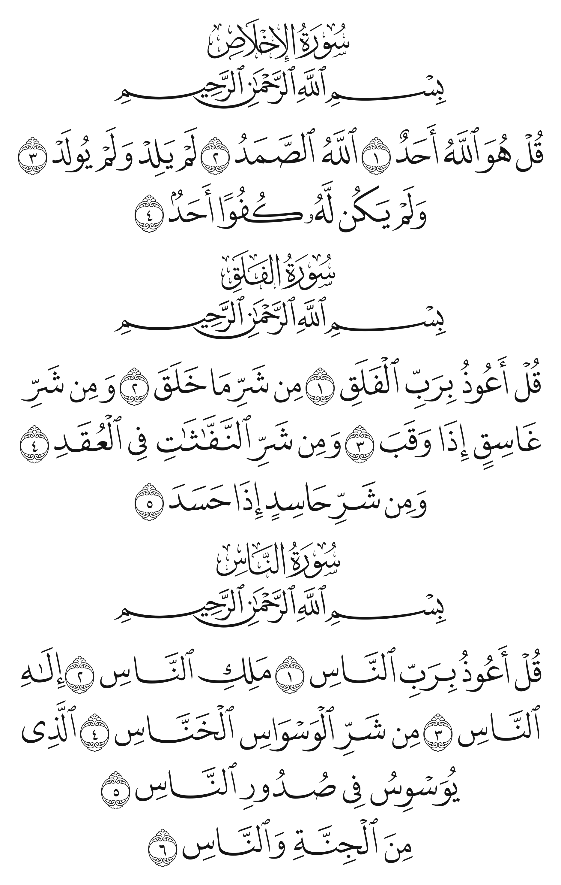
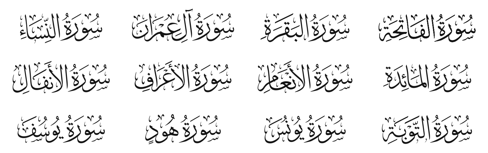

<div align="center">



# Mushaf — Madinah QCF v4 Hafs

**A complete 604-page Madinah Mushaf (Hafs ʿan ʿĀṣim) typeset in Word with the King Fahd Complex QCF v4 fonts, exported to PDF.**

</div>

---

## Contents

| File | Description |
| --- | --- |
| [`Mushaf — Madinah QCF v4 Hafs.pdf`](Mushaf%20—%20Madinah%20QCF%20v4%20Hafs.pdf) | The full Mushaf, A4, fonts embedded |
| [`Mushaf — Madinah QCF v4 Hafs.docx`](Mushaf%20—%20Madinah%20QCF%20v4%20Hafs.docx) | Editable Word source (requires the fonts below to be installed) |
| [`fonts/`](fonts) | `QCF4_Hafs_01_W` … `QCF4_Hafs_47_W` (Quran words and ayah markers) and `QCF4_QBSML` (surah titles and basmala) |
| [`scripts/render_previews.py`](scripts/render_previews.py) | Regenerates the images in this README |

## Pages from the PDF

<table>
  <tr>
    <td align="center"><br><sub>Page 1 · al-Fatiha</sub></td>
    <td align="center"><br><sub>Page 2 · al-Baqarah</sub></td>
  </tr>
</table>

<p align="center">
  <br>
  <sub>Spread · pages 2–3</sub>
</p>

<table>
  <tr>
    <td align="center"><br><sub>Page 3</sub></td>
    <td align="center"><br><sub>Page 302</sub></td>
    <td align="center"><br><sub>Page 604 · al-Ikhlas, al-Falaq, an-Nas</sub></td>
  </tr>
</table>

## Font preview

The images below are drawn **directly from the `.ttf` files in [`fonts/`](fonts)**, not captured from the PDF. They are proof that the fonts on their own reproduce the printed page.

<table>
  <tr>
    <td align="center" width="50%"><br><sub>al-Fatiha · <code>QCF4_Hafs_01_W</code> + <code>QCF4_QBSML</code></sub></td>
    <td align="center" width="50%"><br><sub>Page 604 · <code>QCF4_Hafs_47_W</code> + <code>QCF4_QBSML</code></sub></td>
  </tr>
</table>

<p align="center">
  <br>
  <sub>Surah titles 1–12 from <code>QCF4_QBSML</code> (U+F100 onward)</sub>
</p>

## How the fonts work

QCF ("Quran Complex Font") fonts do not shape Arabic letters. Each **whole word** of the Mushaf is one pre-drawn glyph in the Unicode Private Use Area (`U+F100`–`U+FC7F`), so the line breaks, ligatures and justification of the printed Madinah Mushaf come out exactly the same.

- `QCF4_Hafs_NN_W.ttf`: 47 fonts that together hold every word and ayah-number medallion
- `QCF4_QBSML.ttf`: the decorative surah headers (`سورة …`) and basmala

Because the text is PUA code points, copying text from the PDF does not give readable Arabic. Use it for display and printing, not as a searchable text source.

## Using the Word file

1. Install every font in [`fonts/`](fonts). On macOS, select them all and open them with Font Book. On Windows, right-click and choose **Install for all users**.
2. Open the `.docx`. If any page shows boxes or Latin letters, a font is missing.

## Regenerating the previews

```bash
pip install pymupdf pillow
python3 scripts/render_previews.py
```

## Credits

- Quran fonts: **King Fahd Glorious Qur'an Printing Complex** (مجمع الملك فهد لطباعة المصحف الشريف), QCF v4 Hafs.
- Typesetting and PDF: Aland Kawa Ali.
